<h1 align="center">chessSystem</h1>

<p align="center">
  Partida de <strong>xadrez completa no terminal</strong>, feita em <strong>Java puro</strong> com foco em <strong>orientação a objetos</strong>.
</p>

<p align="center">
  
  
  
</p>

---

## Sobre o projeto

Este projeto simula uma partida de xadrez entre dois jogadores no mesmo terminal. O tabuleiro é desenhado com cores ANSI, os movimentos possíveis da peça escolhida ficam destacados e o sistema valida todas as jogadas: não deixa mover peça do adversário, não deixa o rei ficar em xeque e encerra a partida no **xeque-mate**.

O código é dividido em duas camadas:

- **`boardgame`** — camada genérica de jogo de tabuleiro (tabuleiro, posição, peça). Não sabe nada de xadrez.
- **`chess`** — camada de regras do xadrez, construída em cima da anterior (partida, peças, posição no formato `a1`–`h8`).

Não há bibliotecas externas: apenas a JDK.

### Conceitos aplicados

- **Herança e polimorfismo**: cada peça (`King`, `Queen`, `Rook`, `Bishop`, `Knight`, `Pawn`) implementa o próprio `possibleMoves()`
- **Classes abstratas** (`Piece`, `ChessPiece`) para compartilhar comportamento entre as peças
- **Encapsulamento** com modificadores `protected` para expor a posição da peça só ao tabuleiro
- **Separação em camadas**: a camada `boardgame` é reaproveitável para outros jogos de tabuleiro
- Conversão entre coordenadas da matriz (`Position`) e notação do xadrez (`ChessPosition`)
- **Exceções personalizadas** (`BoardException`, `ChessException`) para jogadas inválidas
- Simulação de jogada com **desfazer movimento** (`makeMove` / `undoMove`) para testar xeque e xeque-mate
- Uso de **Streams** para filtrar peças por cor
- Interface de terminal com **códigos de escape ANSI**

---

## Funcionalidades

- Tabuleiro 8x8 com peças brancas e pretas coloridas
- Destaque em azul das casas para onde a peça selecionada pode ir
- Contador de turnos e indicação do jogador da vez
- Lista de peças capturadas de cada cor
- Validação de jogadas com mensagens de erro
- Detecção de **xeque** e **xeque-mate**

### Jogadas especiais

| Jogada         | Como funciona no sistema                                                                 |
|----------------|------------------------------------------------------------------------------------------|
| **Roque**      | Pequeno e grande. Exige rei e torre sem movimentos, casas livres e rei fora de xeque     |
| **En passant** | O peão que avançou duas casas fica vulnerável à captura apenas no turno seguinte         |
| **Promoção**   | Ao chegar na última fileira, o peão vira Rainha por padrão e o jogador escolhe a peça final (`B`, `N`, `R` ou `Q`) |

---

## Arquitetura

```mermaid
classDiagram
    direction LR

    class Board {
        -int rows
        -int columns
        +piece(Position) Piece
        +placePiece(Piece, Position)
        +removePiece(Position) Piece
        +thereIsAPiece(Position) boolean
    }
    class Position {
        -int row
        -int column
    }
    class Piece {
        <<abstract>>
        #Position position
        +possibleMoves() boolean[][]
        +possibleMove(Position) boolean
        +isThereAnyPossibleMove() boolean
    }
    class ChessPiece {
        <<abstract>>
        -Color color
        -int moveCount
        +getChessPosition() ChessPosition
    }
    class ChessMatch {
        -int turn
        -Color currentPlayer
        -boolean check
        -boolean checkMate
        +performChessMove(ChessPosition, ChessPosition) ChessPiece
        +possibleMoves(ChessPosition) boolean[][]
        +replacePromotedPiece(String) ChessPiece
    }
    class ChessPosition {
        -char column
        -int row
    }
    class Color {
        <<enumeration>>
        WHITE
        BLACK
    }

    Board "1" o-- "*" Piece
    Piece --> Position
    Piece <|-- ChessPiece
    ChessPiece <|-- King
    ChessPiece <|-- Queen
    ChessPiece <|-- Rook
    ChessPiece <|-- Bishop
    ChessPiece <|-- Knight
    ChessPiece <|-- Pawn
    ChessPiece --> Color
    ChessMatch --> Board
    ChessMatch ..> ChessPosition
    King --> ChessMatch : roque
    Pawn --> ChessMatch : en passant
```



A camada `application` (`Main` e `UI`) conversa apenas com a `ChessMatch`. É ela que valida a jogada, move as peças no `Board` e decide se houve xeque, xeque-mate ou promoção.

---

## Estrutura de pastas

```
chessSystem/
├── src/
│   ├── application/
│   │   ├── Main.java             # Loop da partida e leitura das jogadas
│   │   └── UI.java               # Desenho do tabuleiro e cores ANSI
│   ├── boardgame/
│   │   ├── Board.java            # Tabuleiro genérico (matriz de peças)
│   │   ├── BoardException.java   # Erros de posição no tabuleiro
│   │   ├── Piece.java            # Peça abstrata
│   │   └── Position.java         # Linha e coluna na matriz
│   └── chess/
│       ├── ChessMatch.java       # Regras da partida: turnos, xeque, jogadas especiais
│       ├── ChessException.java   # Erros de regra do xadrez
│       ├── ChessPiece.java       # Peça de xadrez (cor e contagem de movimentos)
│       ├── ChessPosition.java    # Posição na notação a1–h8
│       ├── Color.java            # WHITE / BLACK
│       └── pieces/
│           ├── Bishop.java
│           ├── King.java
│           ├── Knight.java
│           ├── Pawn.java
│           ├── Queen.java
│           └── Rook.java
└── README.md
```

---

## Peças

| Letra | Peça    | Classe   |
|:-----:|---------|----------|
| `K`   | Rei     | `King`   |
| `Q`   | Rainha  | `Queen`  |
| `R`   | Torre   | `Rook`   |
| `B`   | Bispo   | `Bishop` |
| `N`   | Cavalo  | `Knight` |
| `P`   | Peão    | `Pawn`   |

As peças **brancas** aparecem em branco e as **pretas** em amarelo. Casas vazias aparecem como `-`.

---

## Como executar

### Pré-requisitos

- **JDK 25** ou mais novo (o `Main` usa o método `main` sem `public`, liberado a partir do Java 25)
- Um terminal com suporte a **cores ANSI** (Windows Terminal, PowerShell 7, Git Bash, terminais Linux/macOS)
- IntelliJ IDEA (opcional)

### 1. Clonar o repositório

```bash
git clone https://github.com/phietrogerbiel-hue/chessSystem.git
cd chessSystem
```

### 2. Compilar

```bash
javac -d out src/boardgame/*.java src/chess/*.java src/chess/pieces/*.java src/application/*.java
```

### 3. Rodar

```bash
java -cp out application.Main
```

> Rode em um terminal de verdade. O console do IntelliJ não interpreta o comando de limpar a tela, então os tabuleiros ficam empilhados.

---

## Como jogar

1. Em **Source**, digite a posição da peça que você quer mover (ex.: `e2`).
2. O tabuleiro mostra em azul as casas para onde ela pode ir.
3. Em **Target**, digite a casa de destino (ex.: `e4`).
4. Se um peão for promovido, escolha a nova peça: `B` (Bispo), `N` (Cavalo), `R` (Torre) ou `Q` (Rainha).

Exemplo de tela no início da partida:

```
8 R N B Q K B N R
7 P P P P P P P P
6 - - - - - - - -
5 - - - - - - - -
4 - - - - - - - -
3 - - - - - - - -
2 P P P P P P P P
1 R N B Q K B N R
  A B C D E F G H

Captured pieces:
White: []
Black: []

Turn : 1
Waiting player: WHITE

Source:
```

Mensagens de erro que podem aparecer:

| Situação                                    | Mensagem                                              |
|---------------------------------------------|-------------------------------------------------------|
| Casa de origem vazia                        | `There is no piece on source position`                |
| Peça do adversário                          | `The chosen piece is not yours`                       |
| Peça sem nenhum movimento possível          | `There is no possible moves for the chosen piece`     |
| Destino inválido para a peça                | `The chosen piece can't move to target position`      |
| Jogada que deixaria o próprio rei em xeque  | `You can't put yourself in check`                     |
| Posição fora do tabuleiro ou mal digitada   | `Error reading ChessPosition. Valid values are from a1 to h8` |

Depois de uma mensagem de erro, pressione **Enter** para continuar.

---

## Limitações conhecidas

- A partida só termina por **xeque-mate**. Não há empate por afogamento, repetição de posição, regra dos 50 lances ou material insuficiente.
- O **roque** não verifica se o rei passa por uma casa atacada, apenas se ele está em xeque no momento.
- Não há desistência, desfazer jogada nem registro da partida em notação PGN.
- Os dois jogadores usam o mesmo terminal; não há modo contra o computador.
